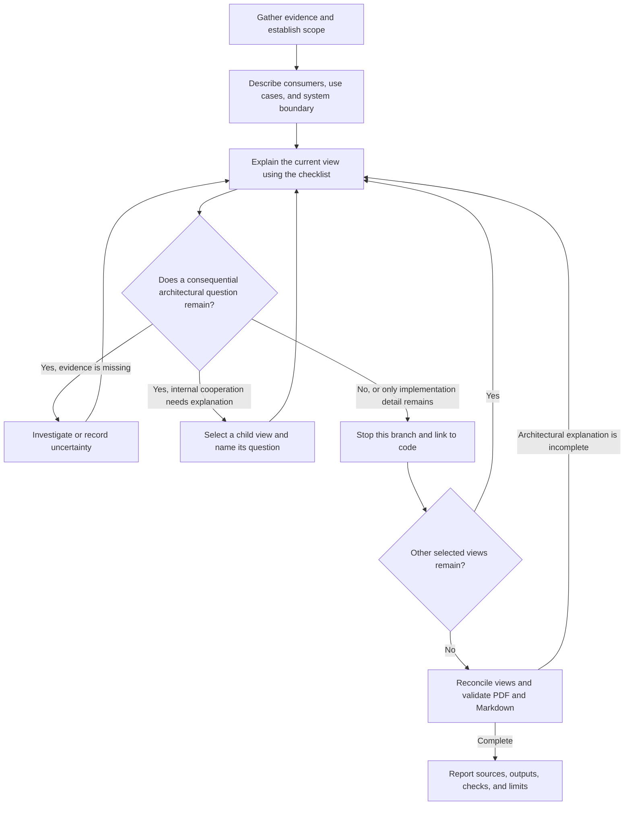

# Document design

## Contract

- Give humans and code agents the same architectural mental model: purpose, boundaries, principal concepts, and their cooperation. Code is authoritative for implemented detail; established owner intent supplies goals, constraints, principles, and rationale.
- Document the system faithfully. This skill does not choose its architecture, redesign its implementation, install workflows, or authorize broad document deletion. Separate implemented facts, accepted unbuilt intent, and unresolved inference; never infer a guarantee from a dependency or one passing test.
- Use the bundled [design-document-syntax](../design-document-syntax/SKILL.md) for file homes, Typst calls, vocabularies, and mechanical checks. Follow the host's pinned version; do not duplicate its contracts here.

## Workflow

### 1. Gather evidence

Read repository instructions, existing documentation, public entry points, tests, and configuration. Trace a representative consumer use case through the implementation; investigate further only where a missing fact changes the explanation. Record supported claims, their evidence, and consequential uncertainties without creating a second implementation ledger.

Ask only for missing owner intent that materially changes the explanation; continue supported work meanwhile. When code contradicts accepted intent, describe the implemented state and preserve the discrepancy through the existing pending mechanism. Preserve decision history and do not invent rationale or ADRs.

### 2. Establish the system view

Always include these clearly labeled sections, placed within the pinned syntax's section structure:

- **Use cases and scope:** identify users or consumers, their problems, representative inputs or actions, and observable outcomes. State what the system provides, what the user or host supplies, external dependencies and trust boundaries, and deliberate exclusions. Put this before internal architecture; for a library, include the integrating developer or calling system.
- **Domain model:** explain the main problem-domain concepts and their relationships, connected to those use cases. Use a high-level model or focus on the main elements; a glossary or component inventory alone is insufficient. A library may model inputs, transformations, results, and errors without business entities or persistence.

Establish goals, non-goals, constraints, invariants, and design principles from evidence. Show how the system interacts with the outside world before decomposing it. Keep the overview readable in a few pages and understandable without opening deeper views; length is guidance, not a gate.

### 3. Explain and selectively refine

Apply the checklist to the whole system, then repeat it for each selected domain, responsibility, or abstraction. At a child view, the outside world includes its siblings and parent. Consider every question, but document only relevant answers; explain an important absence, such as no durable state, instead of filling empty template sections.

| Question                   | Capture at this view                                                                                                                                               |
| -------------------------- | ------------------------------------------------------------------------------------------------------------------------------------------------------------------ |
| Purpose and boundary       | Whose outcome does this part serve? What enters, leaves, or stays outside? What does it own or depend on?                                                          |
| Concepts and data          | What are the principal concepts, relationships, and validity rules? What is authoritative, derived, or transient? Where is incoming data interpreted or validated? |
| State and evolution        | Who owns state? How can it change, and who decides legal transitions? Is the relevant model a state machine, reducer/store, workflow, or another abstraction?      |
| Persistence and durability | What survives restart, where, and under whose authority? Which transaction, consistency, concurrency, retention, or recovery boundaries shape the guarantees?      |
| Actions and control        | What triggers work: a user action, call, event, schedule, or job? Who decides, coordinates, and performs effects? What is synchronous or asynchronous?             |
| Flow and cooperation       | How do the abstractions combine to deliver a representative outcome? Trace important data, control, and state changes across boundaries.                           |
| Failure and constraints    | What happens on refusal, partial failure, duplication, or interruption? Which trust, ordering, retry, idempotency, or operational assumptions affect the model?    |
| Rationale and navigation   | Which supported trade-offs or principles explain this structure? What remains uncertain, and where should a reader investigate in code?                            |

Describe the actual modeling approach and its consequences, not just its technology name. For example, explain which actions enter a Redux-style store, how reducers evolve state, and where effects happen; naming Redux alone does not explain the model. For durable background work, explain what is persisted, what triggers execution, and which retry or recovery assumptions matter.

**Refine only for a named architectural question.** First describe sibling responsibilities at a consistent level and their cooperation. Select a deeper view when hiding its internal abstractions would obscure ownership, a guarantee, a significant lifecycle, or how the outcome is produced. Repeat the checklist there, then reconcile the result with its parent and siblings; do not descend through every branch automatically.

**Stop when the reader can explain the role, concepts, interactions, state ownership, and important constraints, and knows where to investigate further.** Do not require reconstruction from documentation alone. Functions, classes, fields, endpoint catalogues, retry constants, and full schemas normally belong in code or reference documentation; include one only when it changes the architectural explanation. An interface, state, or directory does not by itself justify another view.

Domains, deployment units, storage boundaries, and source modules are different relationships. Do not force them into one hierarchy or invent domains, aggregates, state machines, or databases to match available widgets. Give shared concepts one canonical home and link to them rather than duplicating their explanation. Recursion need not create another file or repeat the system's required sections verbatim.

Adapt the questions to the system: libraries emphasize host responsibilities, resource lifetimes, extension points, side effects, and compatibility; frontends emphasize user journeys, local/server state, rendering, accessibility, offline behavior, and synchronization; backends emphasize callers, authorization, transactions, and asynchronous work. Pipelines emphasize stage inputs, outputs, side effects, reproducibility, and restart behavior. These are lenses, not mandatory architectures.

### 4. Represent and reconcile

Choose the smallest representation that answers the question:

| Meaning                                     | Carrier                                                                          |
| ------------------------------------------- | -------------------------------------------------------------------------------- |
| Purpose, rationale, limits                  | Short prose and applicable foundation blocks                                     |
| Boundaries, responsibilities, relationships | `diagram`; `components` or a table for a short inventory                         |
| Domain model                                | Prose, table, or semantic diagram; `entity` only when its structured fields help |
| State evolution                             | `state-machine`, with abstraction limits explained                               |
| Cooperation over time                       | `sequence` or a short walkthrough                                                |
| Comparisons                                 | Table; chart only for meaningful quantitative evidence                           |
| Otherwise inexpressible drawing             | `figure-block` with a raw `typst` body                                           |

Prefer semantic widgets and solved layout; use `diagram-native` when deliberate positioning conveys meaning. Give each drawing one question, labeled relationships, and a clear scope. Keep ownership, deployment, and temporal views separate when combining them obscures meaning; labels must carry meaning without color. Explain delivery and failure assumptions in adjacent prose.

Raw Typst figures become drawings in PDF and fenced source in Markdown; captions or prose must explain their architectural meaning. Evaluated figure bodies and embedded SVGs remain unsupported by the Markdown projector. Inspect actual projection rather than assuming visual claims survive. New widgets require explicit scope, recurring need, defined semantics, Markdown representation, validation, and gallery coverage.

Walk a representative use case across the completed views. Resolve inconsistent names, boundaries, owners, and guarantees; add failure or recovery paths where they change the architectural understanding. Preserve unique rationale and incoming references when consolidating material. Update generated artifacts through their owner.

### 5. Validate and maintain

- Confirm **Use cases and scope** and **Domain model** appear in both PDF and Markdown. A newcomer should be able to connect consumer outcomes to domain concepts and cooperating abstractions, including significant state and failure boundaries.
- Check claims against evidence and label remaining uncertainty. Review each deeper view's named question and stopping point; remove duplicate or implementation-level detail without losing consequential meaning.
- Render with the pinned tools and run the declared gate. Inspect affected PDF pages for legibility, clipping, and broken relationships; inspect Markdown for the same claims, directions, boundaries, and transitions. Use manifests and exact sections for large projections.
- Report authored sources, rendered outputs, checks performed, and limitations. An unavailable check is not a pass; well-formed documentation neither accepts the architecture nor proves the code implements its claims.
- On later changes, revisit affected views and their parent interactions when purpose, ownership, abstractions, constraints, or important cooperation changes. Ordinary refactoring should usually leave the layer unchanged. Keep current architecture, proposals, and history distinct through existing artifacts.
